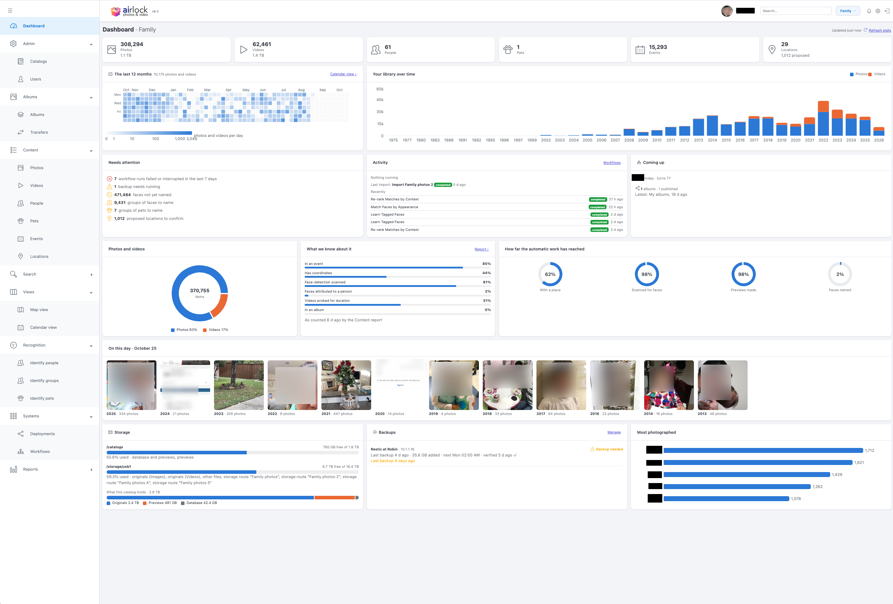

# Airlock Photos

**Airlock Photos** (short name `airlock`) is a self-hosted, AI-assisted photo and video library for importing, organising and identifying the people, pets and places in a personal collection. It runs as podman containers behind an HTTPS gateway: a React UI, a central Python/Flask backend that owns the data and runs workflows, and small services for faces, pets, video, geocoding and local AI models (Ollama).



Current version: see [`VERSION`](VERSION) and `CHANGELOG.md`. A running instance reports its own at `/api/version` and in the sidebar footer.

---

## Table of Contents

1. [Features](#features)
2. [Architecture Overview](#architecture-overview)
3. [Service Endpoints](#service-endpoints)
4. [Prerequisites](#prerequisites)
5. [Quick Start](#quick-start)
6. [Running One Service](#running-one-service)
7. [Project Structure](#project-structure)
8. [Workflows](#workflows)
9. [Key UI Features](#key-ui-features)
10. [API Overview](#api-overview)
11. [Database Design](#database-design)
12. [Configuration](#configuration)
13. [Packing an Album for Elsewhere](#packing-an-album-for-elsewhere)
14. [Sending an Album to Someone Without Airlock](#sending-an-album-to-someone-without-airlock)
15. [Development Notes](#development-notes)
16. [Documentation](#documentation)

---

## Features

### Accounts
- **Sign-in over HTTPS** — Every page and API call needs a session; the first run creates the owner account
- **Users and roles** — Viewer, editor and owner, granted per catalog; managed on the Users page or with `systems/backend/manage_users.py`

### Catalogs, Import and Storage
- **Multi-catalog support** — Each catalog has its own folder and SQLite database, with paths stored relative to it so it can be moved
- **Storage routes** — Import from configured folders; copy, reference in place, or **move** files into the catalog (verified by SHA-256, source removed only after the commit)
- **Streaming import** — Each source file is read once; photos appear while the import runs, with live per-phase progress
- **Photos and video** — HEIC, Canon CR3 RAW, Live Photos and RAW+JPEG pairs as single items; videos transcoded for the browser (hardware-accelerated where available)
- **Dates** — Every item has one decided date (`master_datetime`); dates can be corrected across a whole event at once
- **Removing files** — Items can leave a catalog, with a Removed Files report
- **Storage alerts** — Drives are watched, and an import stops before a disk fills

### People, Pets and Faces
- **Face pipeline** — Find (YuNet), measure (VGG-Face or SFace, chosen per catalog), match, and re-rank by context (events, time, who appears with whom)
- **Identify people / Identify groups** — Confirm or reject suggested matches in bulk; pages stay fast at hundreds of thousands of faces
- **Manual tagging** — Draw or select face regions and name them
- **Pets** — Optional per catalog: animals are detected, grouped and named like people, without ever mixing with faces

### Organisation & Discovery
- **Events** — Photos grouped by time gaps
- **Locations** — Coordinates clustered into places to confirm or reject, place names from OpenStreetMap, one map per catalog; photos without GPS inherit their event's place
- **AI descriptions** — Natural-language descriptions of a photo from a local Ollama vision model
- **Tags and content reports** — Label photos, and browse what a catalog holds

### Albums & Sharing
- **Albums** — Curate photos into albums, organised as a tree of categories, or describe one in words and let a local model select the photos
- **Transfers** — Send an album to another installation with magic-wormhole
- **Mass transfer** — Send one album to several people at once, each with their own code and an optional label; unused codes expire together after up to 3 days, and new ones are one click
- **Deployments** — Publish one or more albums as a shareable gallery, optionally password-protected, with no container to build or restart
- **Video in albums** — Deployed albums play videos: the tile previews on hover, the click opens the browser-friendly version
- **Packing** — Export a deployment as a single tarball that runs anywhere Docker does, with TLS, using [`tools/pack_deployment.py`](tools/pack_deployment.py)

### Running Workflows
- **Queued and chained** — Workflows queue per catalog, run two at a time when their writes don't overlap, and trigger the next step when they finish
- **Stoppable** — Each run is its own process and can be stopped, paused or resumed
- **Live progress and history** — Socket.IO pushes progress; every run is recorded with timing, counts and status

---

## Architecture Overview

```
                     Browser ── https://airlock.lan
                                   │
┌──────────────────────────────────▼──────────────────────────────────┐
│ airlock-gateway (nginx :80/:443) — TLS, routes by name              │
└───────┬──────────────────────┬──────────────────────────┬───────────┘
        ▼                      ▼                          ▼
┌───────────────┐  ┌──────────────────────────┐  ┌──────────────────┐
│ frontend      │  │ backend (Flask) :5000    │  │ album-gallery    │
│ React :3000   │  │ API · auth · Socket.IO   │  │ :3001 published  │
└───────────────┘  │ workflow scheduler       │  │ deployments      │
                   │ catalogs.db + one SQLite │  └──────────────────┘
                   │ DB per catalog           │
                   └──┬─────┬─────┬─────┬─────┘
                      ▼     ▼     ▼     ▼
              deepface   pets  transcode  geoloc     vision · albums
               :5001    :5006   :5004     :5002      :5003    :5005
              faces    animals  video    places        └──► Ollama (host)
```

See [`docs/architecture/ARCHITECTURE.md`](docs/architecture/ARCHITECTURE.md) for the full system architecture, and [`docs/architecture/INFORMATION_FLOW.md`](docs/architecture/INFORMATION_FLOW.md) for data flow diagrams.

---

## Service Endpoints

Services are addressed by name through the gateway (`systems/gateway`). It
redirects :80 to HTTPS on :443 and routes by Host header and path. The ports
below still exist, but nothing in the application refers to them — the gateway
config is the only place that maps a name to a port.

| Service | Name | Internal port |
|---|---|---|
| UI | https://airlock.lan | 3000 |
| Main Backend | https://airlock.lan/api · http://backend.airlock.lan | 5000 |
| DeepFace | http://deepface.airlock.lan | 5001 |
| GeoLocation | https://airlock.lan/geoloc · http://geoloc.airlock.lan | 5002 |
| Vision | https://airlock.lan/vision · http://vision.airlock.lan | 5003 |
| Transcode | http://transcode.airlock.lan:5004 (called directly, not through the gateway) | 5004 |
| Albums | http://albums.airlock.lan | 5005 |
| Pets (only if a catalog has pets on) | http://pets.airlock.lan | 5006 |
| Album Gallery | https://gallery.airlock.lan · https://&lt;catalog&gt;.airlock.lan/&lt;album&gt; | 3001 |
| Ollama (on the host) | http://ollama.airlock.lan | 11434 |
| Gateway health | http://airlock.lan/gateway-health | 80 |

The plain-HTTP service names are for container-to-container calls; browsers use
`https://airlock.lan`. Old `shoebox.lan` links redirect permanently to the same
path on `airlock.lan`.

The names need `/etc/hosts` entries, and devices need to trust the gateway's
private CA once:

```bash
sudo systems/gateway/make-hosts.sh --install
systems/gateway/make-hosts.sh --check
systems/gateway/make-certs.sh          # CA + certificate; --force renews the certificate, keeping the CA
```

See `docs/specs/redesign-ports-routes-spec.md`.

---

## Prerequisites

Almost everything runs in a container and brings its own dependencies. This
table is the short list of what has to be on the **host** itself.

| Dependency | Minimum Version | Purpose |
|---|---|---|
| podman | 4.7+ recommended | Runs every containerised service |
| Python | **3.10+** | The services that run natively (3.12 is what the images use) |
| ffmpeg + ffprobe | any | Native `backend-transcode` only (hardware video previews) |
| ExifTool | any | EXIF metadata extraction (must be in `PATH`) |
| Ollama | any | Local vision AI for image descriptions |
| Node.js / npm | 16+ / 8+ | Only for a frontend dev server outside the container |

**Why Python 3.10 and not 3.8.** `backend-deepface` needs current Flask and
TensorFlow, neither of which publishes anything for 3.9. A venv built with
Apple's bundled `python3` — 3.9.6, and still what bare `python3` resolves to on
a Mac with Homebrew Python installed — cannot install these requirements at all.
The start scripts therefore pick the newest `python3.1x` on `PATH` rather than
trusting `python3`; override with `AIRLOCK_PYTHON` in `deploy/airlock.env`.

Missing either of the first two costs an *accelerator*, not a service: the mode
for that service falls back to a container, which carries its own Python and
ffmpeg. `./deploy/deploy.sh --check` reports what this machine can do.

**On macOS, give the podman machine memory.** Every container shares one Linux
VM created with 2048 MB by default — the Mac's own RAM is invisible inside it.
`backend-deepface` holds ~600 MB per worker and will have its workers OOM-killed
in a loop at that size. 6 GB is comfortable:

```bash
podman machine stop && podman machine set --memory 6144 && podman machine start
```

The start scripts size deepface's workers to whatever the VM has and skip the
model warm-up below 3 GB, so it boots and serves detection either way — but
recognition wants the memory.

```bash
# macOS
brew install python@3.12 ffmpeg exiftool

# Ubuntu / Debian / Raspberry Pi OS (64-bit)
sudo apt install python3.12 python3.12-venv ffmpeg libimage-exiftool-perl
```

### Supported platforms

| Platform | Notes |
|---|---|
| macOS on Apple Silicon | Native face and video services (Metal, VideoToolbox) |
| macOS on Intel | Native video service; faces run in a container — TensorFlow publishes no macOS x86_64 wheel after 2.16 |
| Linux x86_64 | Containers throughout; NVIDIA GPU used when a driver and CDI spec are present |
| Linux arm64 (Raspberry Pi 64-bit) | Containers throughout. A 32-bit OS will not work: no TensorFlow wheels exist for it |

Install and start Ollama with the two default models (vision descriptions and
album prompts; change them with `OLLAMA_MODEL` and `ALBUMS_LLM_MODEL`):
```bash
# Install Ollama from https://ollama.com
ollama pull gemma4:latest
ollama pull granite3.3:8b
ollama serve
```

---

## Quick Start

**On a machine that has run this before:**

```bash
./start-all.sh
```

**On a new machine** — first prepare it, which is one extra step and is
mandatory on Linux:

```bash
./deploy/deploy.sh          # check the host, create the directories, fix ownership
./start-all.sh --build      # build every image, then start
```

`deploy/deploy.sh --check` reports without changing anything, and is the fastest
way to find out why a container will not start. Host-specific paths live in
`deploy/airlock.env` — one file, not one edit per script. See
[deploy/README.md](deploy/README.md), which also explains why rootless podman on
Linux needs an ownership step that macOS does not.

`deploy/deploy.sh` prepares the **host**:
1. Checks podman, its mode, and the host tools the stack needs
2. Writes `deploy/airlock.env` if it does not exist
3. Creates the host directories that get bind-mounted, and checks you own them
4. Downloads the YuNet face detector, which nothing fetches lazily
5. Builds the Python virtual environments for the services that will run
   natively on this machine, and caches the face models

`start-all.sh` then builds the images and starts everything in dependency
order, printing the mode each accelerated service resolved to and why.

**Rebuilding after a code change.** Each service rebuilds its own image when its
sources are newer than it, so a plain `./start-all.sh` usually suffices. To force
it for particular services, `--build` takes a list:

```bash
./start-all.sh --build=frontend,backend   # the two that hold compiled code
./start-all.sh --build                    # every image
./start-all.sh --help                     # the names it accepts
```

`frontend` is the one that always needs this after editing `systems/frontend/src`:
it is a two-stage image where `npm run build` runs *inside* it, nothing is mounted
from the host, and Create React App inlines `REACT_APP_*` at build time — so the
old bundle is served until the image is rebuilt. `backend` bakes in `app.py`,
`models.py` and the rest, though `workflows/` is bind-mounted and needs no
rebuild. An unknown name is refused with the list rather than ignored, because a
typo that silently skipped the build would report success and serve the old code.

Stop all services:
```bash
./stop-all.sh
```

`stop-all.sh` does not stop `backend-pets` yet; stop it with
`podman stop backend-pets` if it is running.

Once running, open **https://airlock.lan**. On a new installation it asks you
to create the owner account; after that it asks you to sign in.

**Logs** are written to `./logs/`, one file per service. Services running
natively (see below) keep their pid files there too.

**Restarting interrupts workflows, and ends waiting transfer codes.**
`start-all.sh` replaces every container, including the backend that runs
workflows and album transfers. Check the Operations page first, and Albums ▸
Transfers for codes still waiting for someone - after a restart those need new
codes. Or restart only the service you changed (next section).

---

## Running One Service

Each service under `systems/` starts on its own:

```bash
cd systems/<service>
./start-podman.sh            # (re)start its container; --build rebuilds the image
./start-host.sh              # deepface and transcode only: run natively
```

`backend-deepface` and `backend-transcode` choose between native, container
and GPU with `AIRLOCK_DEEPFACE_MODE` / `AIRLOCK_TRANSCODE_MODE`
(`auto | host | container | gpu | off`) in `deploy/airlock.env`;
`start-all.sh` prints what each resolved to and why. See
[`docs/specs/accelerated-services-spec.md`](docs/specs/accelerated-services-spec.md).

For frontend work outside the container:

```bash
cd systems/frontend
npm install
npm start
```

---


## Project Structure

```
airlock/
├── start-all.sh / stop-all.sh    ← Start or stop the whole stack
├── VERSION, CHANGELOG.md         ← Version and release notes (every commit is a tagged patch)
├── deploy/                       ← Per-machine setup (see deploy/README.md)
│   ├── deploy.sh                 ← Prepare a host; --check reports only
│   ├── airlock-env.sh            ← Shared settings and service-mode logic
│   ├── airlock.env.example       ← Template for deploy/airlock.env (host paths, modes)
│   ├── status.sh                 ← Health, storage and import report
│   └── move-to-opt-airlock.sh    ← Move an install from /opt/shoebox to /opt/airlock
│
├── systems/                      ← One directory per service, each with start-podman.sh
│   ├── gateway/                  ← nginx: airlock.conf.template, make-certs.sh, make-hosts.sh
│   ├── frontend/                 ← React UI (src/views, src/components, src/config.js)
│   ├── backend/                  ← Flask API
│   │   ├── app.py                ← Routes
│   │   ├── auth.py, manage_users.py
│   │   ├── catalog.py, catalog_layout.py, storage_routes.py
│   │   ├── embedding_models.py   ← Face model registry and thresholds
│   │   ├── workflow_scheduler.py, workflow_triggers.py
│   │   ├── migrate_*.py          ← Database migrations, run explicitly
│   │   ├── database/             ← catalogs.db, secret_key, instance_id
│   │   └── workflows/            ← Workflow scripts (bind-mounted), lib/, defaults.json
│   ├── backend-deepface/         ← Face detection and embeddings (+ start-host.sh)
│   ├── backend-pets/             ← Animal detection and identity
│   ├── backend-transcode/        ← Video proxies and posters (+ start-host.sh)
│   ├── backend-geoloc/           ← Place names
│   ├── backend-vision/           ← Photo descriptions (Ollama)
│   ├── backend-albums/           ← Album prompts → SQL (Ollama)
│   ├── album-gallery/            ← Published deployments (server.mjs + app/)
│   └── test_*.py                 ← Cross-service checks (names, pod manifests)
│
├── catalogs/                     ← One folder per catalog (workflow_results.db, originals, cache/)
├── IN/                           ← Default import drop folder
├── tools/                        ← Operator scripts: pack_deployment.py,
│                                   migrate_embedding_model.py, fetch_*_weights.sh, …
├── docs/                         ← architecture/, guides/, features/, specs/, images/
└── logs/                         ← Service logs (and pid files for native services)
```

---

## Workflows

Workflows are Python scripts in `systems/backend/workflows/` that process one
catalog. The backend's scheduler drains each catalog's queue, at most two at a
time and never two that write the same tables, and runs each as a subprocess:

```
python -u <script>.py --execution-id N --target-dir <catalog dir> --catalog-id ID [--source-dir … --route-id …]
```

so a run can be stopped, and its output goes to the workflow log unbuffered.
Finishing one queues the workflows that depend on it (`workflow_triggers.py`).
The scripts are bind-mounted: editing one needs no image rebuild.

| Workflow | Script | What it does |
|---|---|---|
| Import Files | `io_picture_import_v2_workflow.py` | Streaming import from a storage route: one read per file, copy/reference/move, derivatives in the background. Created per storage route |
| Legacy Two-Stage Import | `io_picture_import_workflow.py` | The earlier import, kept selectable |
| Create Events | `ev_extract_events.py` | Groups photos into events by time gaps |
| Extract Locations | `ge_extract_locations.py` | Clusters coordinates into proposed locations |
| Resolve Locations | `ge_resolve_locations.py` | Gives each photo its place; photos without GPS inherit their event's |
| Find Faces | `ai_auto_detect_faces_workflow.py` | Detects faces (and pets, when on) and saves crops |
| Measure Faces | `ai_embed_faces.py` | Embeddings for detected faces, tagged with their model |
| Learn Tagged Faces | `ai_ingest_manual_faces.py` | Embeddings for faces people have named |
| Match Faces by Appearance | `ai_face_recognition_workflow.py` | Scores every unnamed face against every person |
| Re-rank Matches by Context | `ai_contextual_recognition_workflow.py` | Adjusts scores with events, time and co-appearance; groups unnamed faces |
| Measure and Match Pets | `pe_identify_pets.py` | Pet embeddings and matches (pets on only) |
| Group Unnamed Pets | `pe_cluster_pets.py` | Groups animals nobody has named yet (pets on only) |

---

## Key UI Features

- **Photos / Videos** — Browse by day with a date slider; the server sends one page around what is on screen.
- **Identify people / Identify groups** — Suggested matches per person, or clusters of unnamed faces, to confirm or reject in bulk.
- **People / Pets** — Directories with categories, profile pictures and every photo of each.
- **Events** — Time-based groups; dates can be corrected for a whole event at once.
- **Locations** — Proposed places to confirm, a gallery per place, and a catalog map.
- **Albums** — Album trees, prompt-built albums, deployments and transfers.
- **Operations** — Workflow cards, queue, chains, and execution history; **Import Progress** shows an import phase by phase.
- **Catalogs, Storage, Alerts** — Catalog settings (ingest mode, pets, face model), storage routes, drive alerts.
- **Users** — Accounts and per-catalog roles.

---

## API Overview

The backend serves about 220 routes under `/api/`, reached at
`https://airlock.lan/api/…`. Every route needs a signed-in session except
`/api/auth/login`, `/api/auth/session`, `/api/auth/setup` and
`/api/auth/setup-required`.

| Area | Routes |
|---|---|
| Auth and users | `/api/auth/*` (login, logout, password, sessions, setup), `/api/users/*` |
| Catalogs | `/api/catalogs`, `/api/catalogs/<id>` and its `access`, `storage-routes`, `embedding-model` |
| Files and media | `…/photos`, `…/videos`, `…/files`, `…/images`, `…/removed-files`, `…/imports` |
| Faces and people | `…/faces`, `…/people`, `…/people-categories`, `/api/people/*` |
| Pets | `…/pets`, `…/pet-detections` |
| Events and locations | `…/events`, `…/locations`, `…/location-clusters`, `…/geocode` |
| Albums | `…/albums`, `…/album-templates`, `…/deployments`, `…/transfers`, `…/mass-transfer`, `…/transfer-batches` |
| Workflows | `…/workflows`, `…/queue` (run, chain, stop, pause, resume), `…/executions`, `…/workflow-graph`, `/api/workflows/*` |
| System | `/api/version`, `/api/alerts`, `/api/storage-routes`, `/api/systems`, `/api/user/settings` |

(`…` is `/api/catalogs/<id>`.) Live progress is Socket.IO at `/socket.io/`.

---

## Database Design

All SQLite in WAL mode, in two kinds of database:

- **`systems/backend/database/catalogs.db`** — the application: `catalog_meta`, `storage_routes`, `users`, `sessions`, `catalog_access`, `alerts`, `user_settings`, `scheduler_lease`.
- **`catalogs/<catalog>/workflow_results.db`** — one per catalog, everything about its files:

| Tables | Holds |
|---|---|
| `file_contents`, `exif_data`, `exif_raw` | Files, their date (`master_datetime`) and EXIF; the raw EXIF blob lives apart in `exif_raw` |
| `alternative_versions` | Image rungs, video proxies and posters |
| `face_detections`, `ai_face_contents`, `face_contents` | Faces, crops and embeddings (with the model that made them) |
| `face_similarity_scores`, `face_best_match` | Match scores, and each face's best match kept current by triggers |
| `pet_detections`, `pet_*` | Pets — created only when pets are turned on |
| `people` | People and pets (`kind`), with categories |
| `events`, `event_files` | Events |
| `locations`, `location_clusters`, `file_locations` | Places and how each photo got its place |
| `albums`, `album_*`, `album_deployments`, `wormhole_transfers`, `wormhole_transfer_batches` | Albums, publishing and transfers |
| `workflows`, `workflow_queue`, `workflow_executions`, `import_phases` | Workflows and their runs |
| `catalog_properties` | Per-catalog settings (`pets_enabled`, `embedding_model`, …) |
| `tags` | Photo tags |

Paths inside a catalog database are relative to the catalog. Schema changes
ship as `systems/backend/migrate_*.py` scripts; the heavy ones run in phases
with the backend stopped. See
[ARCHITECTURE.md](docs/architecture/ARCHITECTURE.md#data-architecture).

---

## Configuration

Per-machine settings live in **`deploy/airlock.env`** (copy
`deploy/airlock.env.example`; `deploy/deploy.sh` writes one): host folders for
catalogs, imports and storage, the LAN address, service modes, and import and
deepface tuning. Settings are `AIRLOCK_*`; the old `SHOEBOX_*` names and
`deploy/shoebox.env` are still read until v5.7.

| Setting | Effect |
|---|---|
| `AIRLOCK_AUTH_REQUIRED` | Sign-in required (default `1`) |
| `AIRLOCK_DEEPFACE_MODE`, `AIRLOCK_TRANSCODE_MODE` | `auto`, `host`, `container`, `gpu` or `off` |
| `AIRLOCK_ALLOWED_ORIGINS` | Extra origins the backend accepts |
| `OLLAMA_MODEL`, `ALBUMS_LLM_MODEL` | Models for descriptions and album prompts |

Per catalog, on the Catalogs page: ingest mode (copy, reference, move), pets on
or off, and the face model (VGG-Face or SFace; switch an existing catalog with
`tools/migrate_embedding_model.py`). Face-match thresholds are set per model in
`systems/backend/embedding_models.py`.

**License notice.** A copy can carry a signed license file naming who it is
licensed to. Put it in the **`license/`** folder at the top of the repository
(the backend sees it at `/license`; see `license/README.md`); it is read again
when it changes, so no restart.
The version badge's tooltip then says *Licensed to …*; without a valid license
a red **Unlicensed - No commercial use** appears beside the logo, and the tooltip
says why (*Unlicensed copy* or *License not valid*). It is a good-faith notice: nothing is ever disabled, with or
without a license. Licenses are issued by the maintainer and checked against the
public key in `systems/backend/airlock_license.py`.

---

## Packing an Album for Elsewhere

A published deployment can be exported as a single tarball that runs on any
machine with Docker — a cloud VM, a NAS, a friend's laptop — with no airlock and
no path back to this installation.

```bash
# 1. Publish the deployment in the UI (Albums -> Deployments -> Publish)
# 2. Pack it
tools/pack_deployment.py \
    --catalog family --deployment album2026 \
    --domain photos.example.com \
    --image ghcr.io/YOU/album-gallery:latest \
    --out ./dist

# 3. On the destination machine
tar xzf album2026-20260907.tar.gz && cd album2026
echo "ALBUM_SESSION_SECRET=$(openssl rand -hex 32)" > .env
docker compose up -d
```

The bundle carries the album's images, video proxies and manifests as **real
files**, plus a `compose.yml` and a `Caddyfile` that obtains a TLS certificate
automatically for the domain you pass. A password-protected deployment stays
protected.

**Why a tool rather than `tar`:** a deployment directory is a farm of symlinks
into the catalog cache. Copying it with `cp -r` or `tar` (without `-h`) produces
a bundle of a few hundred bytes in which every image 404s. The packer
dereferences every link and fails loudly on one that does not resolve.

Typical size: a 3.9 GB catalog produces a ~38 MB album bundle, because a
deployment carries the 1200px derivatives and video proxies, never the originals.

See [PACKING-TOOL.md](docs/features/PACKING-TOOL.md) for the options,
the static-host target, and troubleshooting.

---

## Sending an Album to Someone Without Airlock

*A recommendation, not built yet (2026-10-23).*

**Today**, an album transfer (**Albums → Transfer**) goes from one Airlock to
another. It runs over [magic-wormhole](https://magic-wormhole.readthedocs.io/),
with Airlock's own protocol on top (`airlock.app/album-transfer`): a manifest of
every file with its SHA-256, resume after an interruption, and a check of every
file on arrival. The standard `wormhole receive` tool does not speak that
protocol, so both ends must be Airlock. It sends the **originals**, RAW and HEIC
included, because it is for another catalog to take the photos in properly.

**The recommendation: a "send to anyone" mode on magic-wormhole's standard file
protocol.** Airlock shows a wormhole code (e.g. `7-crossover-clockwork`); the
recipient types it into any ordinary magic-wormhole app and gets the album as a
folder. They install nothing of ours, and there are self-contained apps for every
desktop:

| Recipient on | App | Notes |
|---|---|---|
| Windows, macOS, Linux | [Rymdport](https://github.com/Jacalz/rymdport/releases) | A window: type the code, pick a folder. One self-contained program (Go, on the wormhole-william implementation); no Python. On Apple Silicon, macOS may quarantine it because it is not signed by Apple: `xattr` removes that. |
| Windows, macOS | [Magic Wormhole UI](https://libraries.io/pypi/wormhole-ui) | Installers for both |
| Command line | `wormhole receive <code>` | `brew install magic-wormhole`, `pip`, or the distribution's package; wormhole-william is a single-binary alternative |
| A web browser | [Winden](https://magic-wormhole.readthedocs.io/en/latest/ecosystem.html) | Nothing to install, but beta, and both sides must use the same mailbox server: test it against Airlock before suggesting it |

What the standard protocol gives up: no resume (an interrupted transfer starts
again), the sender zips the album first (temporary disk the size of the album),
and integrity is the protocol's own encryption rather than a per-file checksum
list. For people who just want the pictures, the mode should offer **"Photos to
view"** (the display JPEGs a published gallery uses: small, and they open
everywhere) beside **"Originals"**.

**Later, if large transfers that need resume become common:** a self-contained
Airlock receiver for the existing protocol - `wormhole_runner.py`'s receive side
packaged with PyInstaller as a Windows `.exe` and a macOS `.app`. It must be built
on each platform and signed to avoid security warnings (an Apple Developer
account and notarization; a Windows code-signing certificate). A smaller Go
version on wormhole-william would need Airlock's protocol to stop relying on
magic-wormhole's "dilation", which wormhole-william is not known to support.

magic-wormhole and Twisted are MIT-licensed, so both fit a commercial edition. By
default transfers use the project's public relay servers; heavy use would justify
running your own (`WORMHOLE_RELAY_URL`, `WORMHOLE_TRANSIT_RELAY`).

---

## Development Notes

- Python services run under gunicorn in their containers; the backend is one worker with eight threads.
- The frontend is built inside its image (`--build=frontend` after editing `src/`).
- Every commit bumps `VERSION` and is tagged; see the top of `CHANGELOG.md`.
- Tests live beside each service (`systems/backend/test_*.py`) and in `systems/test_*.py`, which keep service names, pod manifests and the `airlock` names consistent.
- Restarting the backend interrupts running workflows and ends album-transfer codes still waiting; restart only the service you changed when you can.

---

## Documentation

Full documentation is in the [`docs/`](docs) directory:

| Document | Description |
|---|---|
| [Architecture](docs/architecture/ARCHITECTURE.md) | Services, gateway, data and workflows |
| [Technology Stack](docs/architecture/TECHNOLOGY_STACK.md) | Technologies and versions |
| [Information Flow](docs/architecture/INFORMATION_FLOW.md) | How requests, imports, faces, pets and albums flow |
| [Deploy README](deploy/README.md) | Preparing a machine, `airlock.env`, rootless podman |
| [Startup Guide](docs/guides/STARTUP_GUIDE.md) | Starting and managing services |
| [Quick Start](docs/guides/QUICKSTART.md) | Step-by-step first run |
| [Accelerated Services](docs/specs/accelerated-services-spec.md) | Native, container and GPU modes |
| [Ports and Routes](docs/specs/redesign-ports-routes-spec.md) | The gateway and service names |
| [User Authentication](docs/specs/user-authentication-spec.md) | Accounts, roles, sessions |
| [Ingestion Architecture](docs/features/ingestion-architecture.md) | How the streaming import works |
| [Pet Recognition](docs/specs/pet-recognition-spec.md) | Pets: models, thresholds, design |
| [Name Migration](docs/specs/name-migration-spec.md) | The Shoebox → Airlock Photos rename and what remains |
| [Packing Tool](docs/features/PACKING-TOOL.md) | Exporting a deployed album to run anywhere |
| [Album Deployments](docs/features/albums-enhancement-spec.md) | Deployments, publishing, packing — design and rationale |

---

## License

**Personal and non-commercial use only** — see [license.txt](license.txt).

The Software may be used by an individual for private, educational or
recreational purposes. Commercial use is not permitted, including use inside a
business, providing services to third parties, monetisation, or use in the
course of employment. Contact the Licensor about a commercial licence.
